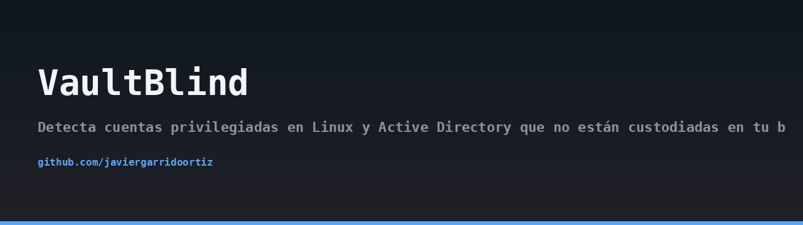
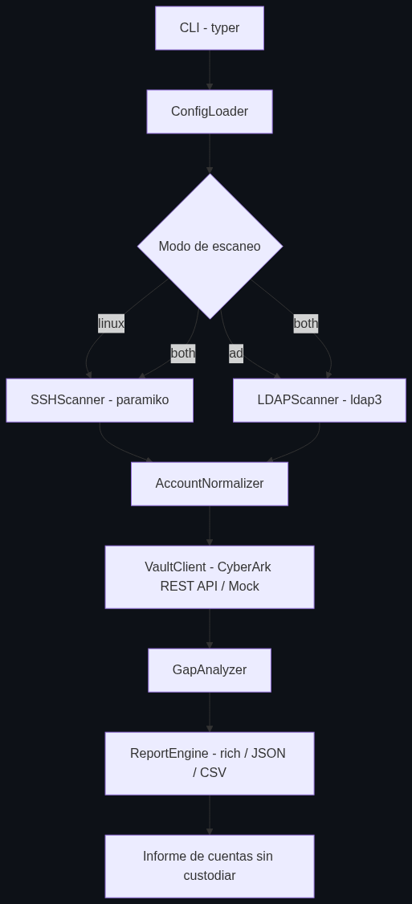
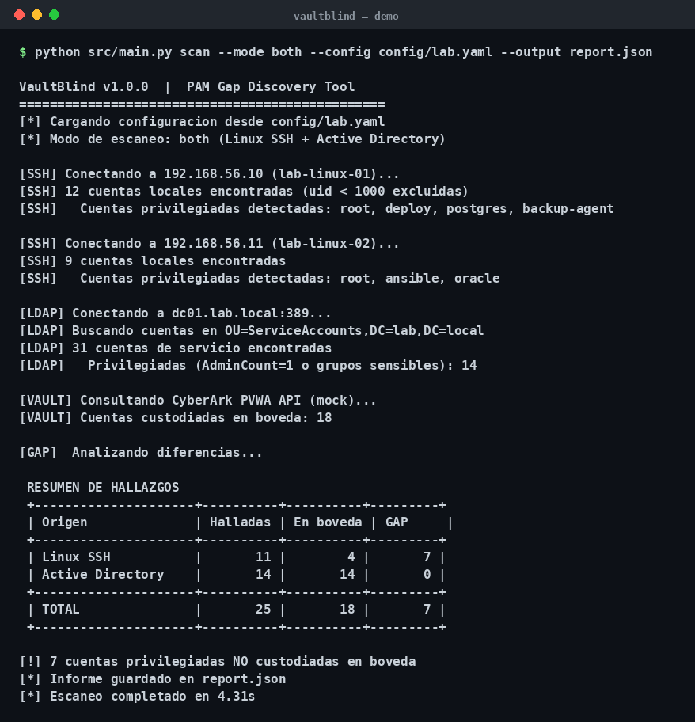
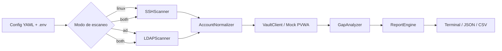

## Arquitectura



## Demo



> 🇬🇧 Read this in [English](README.en.md).

# VaultBlind

[](https://www.python.org/)
[](LICENSE)
[]()

VaultBlind detecta cuentas privilegiadas en sistemas Linux y en Active Directory que no están custodiadas en tu bóveda CyberArk. El proyecto compara las cuentas descubiertas en el entorno con las cuentas registradas en la PVWA (Password Vault Web Access) y genera un informe de brechas (gaps) accionable.

## El problema

Las organizaciones suelen confiar en CyberArk para custodiar credenciales privilegiadas, pero la bóveda solo protege lo que alguien ha registrado en ella. Con el tiempo aparecen cuentas con privilegios elevados que nunca fueron onboardeadas: cuentas locales con UID 0, entradas en sudoers, miembros de Domain Admins, cuentas con `AdminCount=1`, etc. Esas cuentas son el eslabón débil: no rotan, no se auditan y no tienen trazabilidad. VaultBlind cierra esa brecha comparando el inventario real con el inventario custodiado.

## Arquitectura

VaultBlind sigue un pipeline lineal: discovery → normalización → comparación → reporte.



Módulos principales:

- `src/main.py`: CLI basado en Typer.
- `src/scanner_ssh.py`: descubre cuentas privilegiadas en hosts Linux vía Paramiko.
- `src/scanner_ldap.py`: descubre cuentas privilegiadas en AD vía ldap3.
- `src/models.py`: modelos normalizados (`AccountRecord`).
- `src/vault_client.py`: cliente de la API REST de CyberArk PVWA.
- `src/gap_analyzer.py`: set difference entre descubiertas y custodiadas.
- `src/report_engine.py`: salida con Rich, JSON o CSV.
- `src/config_loader.py`: carga y valida el YAML de configuración.
- `src/mock_pvwa.py`: servidor FastAPI que emula la PVWA para pruebas.

## Requisitos previos

- Python 3.11 o superior.
- Acceso SSH a hosts Linux de laboratorio, o acceso LDAP a un Domain Controller de laboratorio.
- Alternativa: usar el modo mock incluido, que no requiere bóveda real.
- Credenciales y secretos siempre mediante variables de entorno.

## Instalación

```bash
git clone https://github.com/javiergarrido/vaultblind.git
cd vaultblind
python -m venv .venv
source .venv/bin/activate
pip install -r requirements.txt
cp config/lab.yaml.example config/lab.yaml
cp .env.example .env
```

Edita `config/lab.yaml` con tus hosts y dominio. Edita `.env` con los secretos:

```
VAULTBLIND_SSH_USER=labuser
VAULTBLIND_SSH_KEY_PATH=/home/labuser/.ssh/id_ed25519
VAULTBLIND_LDAP_USER=svc-vaultblind
VAULTBLIND_LDAP_PASSWORD=cambia_esto
VAULTBLIND_PVWA_USER=svc-pvwa
VAULTBLIND_PVWA_PASSWORD=cambia_esto
VAULTBLIND_PVWA_BASE_URL=https://pvwa.lab.local
```

Nunca subas `.env` ni `config/lab.yaml` al repositorio. Ambos están en `.gitignore`.

## Uso

Escaneo de hosts Linux:

```bash
python src/main.py scan --mode linux --config config/lab.yaml --output table
```

Escaneo de Active Directory:

```bash
python src/main.py scan --mode ad --config config/lab.yaml --output json
```

Escaneo combinado con salida CSV:

```bash
python src/main.py scan --mode both --config config/lab.yaml --output csv --out-file gaps.csv
```

Escaneo usando el mock de PVWA (sin bóveda real):

```bash
python src/mock_pvwa.py &
python src/main.py scan --mode both --config config/lab.yaml --mock --output table
```

## Fichero de configuración YAML

El fichero `config/lab.yaml` se valida con un schema interno en `src/config_loader.py`. Tiene tres secciones.

Sección `hosts`: lista de hosts Linux a escanear.

```yaml
hosts:
  - name: srv-app-01
    address: 10.0.10.11
    port: 22
    user_env: VAULTBLIND_SSH_USER
    key_env: VAULTBLIND_SSH_KEY_PATH
  - name: srv-db-01
    address: 10.0.10.12
    port: 22
    user_env: VAULTBLIND_SSH_USER
    key_env: VAULTBLIND_SSH_KEY_PATH
```

Sección `ldap`: parámetros del Domain Controller.

```yaml
ldap:
  server: ldap://dc01.lab.local
  base_dn: DC=lab,DC=local
  user_env: VAULTBLIND_LDAP_USER
  password_env: VAULTBLIND_LDAP_PASSWORD
  sensitive_groups:
    - Domain Admins
    - Backup Operators
    - Account Operators
    - Enterprise Admins
```

Sección `vault`: parámetros de la PVWA.

```yaml
vault:
  base_url_env: VAULTBLIND_PVWA_BASE_URL
  user_env: VAULTBLIND_PVWA_USER
  password_env: VAULTBLIND_PVWA_PASSWORD
  safe: LabPrivileged
  verify_tls: true
```

## Mock server

El mock emula los endpoints de la PVWA con datos de ejemplo. Es útil para desarrollo, demos y tests sin dependencias externas.

```bash
python src/mock_pvwa.py
```

Por defecto escucha en `http://127.0.0.1:8000`. El flag `--mock` del CLI apunta automáticamente a esa URL. Los datos servidos están en el propio módulo y no contienen secretos.

## Campos del informe de gap

Cada fila del informe representa una cuenta descubierta que no aparece en la bóveda.

| Campo | Descripción |
|---|---|
| `username` | Nombre de la cuenta descubierta. |
| `origin` | Origen del hallazgo: `linux` o `ad`. |
| `host_or_domain` | Host Linux o dominio AD donde se encontró. |
| `privilege_group` | Grupo o mecanismo que otorga el privilegio (sudoers, Domain Admins, UID 0...). |
| `detected_at` | Marca temporal UTC del descubrimiento. |
| `in_vault` | Indica si la cuenta está custodiada (`true`/`false`). |
| `severity` | Severidad calculada según el privilegio y la exposición. |

La clave de identidad para la comparación es el par `(username, host_or_domain)`. Dos cuentas con el mismo nombre en hosts distintos se consideran cuentas distintas.

## Advertencia ética

VaultBlind es una herramienta defensiva de auditoría. Úsala únicamente en entornos propios o en entornos para los que tengas autorización escrita explícita. El escaneo de sistemas ajenos sin permiso puede constituir un delito. El autor no se responsabiliza del uso indebido de esta herramienta.

## MITRE ATT&CK

VaultBlind ayuda a detectar y cerrar brechas asociadas a las siguientes técnicas:

- **T1078 Valid Accounts**: cuentas privilegiadas válidas fuera de la bóveda son cuentas válidas que un atacante puede reutilizar sin necesidad de explotar vulnerabilidades.
- **T1087 Account Discovery**: el descubrimiento sistemático de cuentas privilegiadas es también una técnica de reconocimiento; VaultBlind la aplica de forma controlada y autorizada para inventariar la superficie de identidad.

## Licencia

Distribuido bajo licencia MIT. Consulta el fichero [LICENSE](LICENSE) para más detalles.

Autor: Javier Garrido Ortiz.